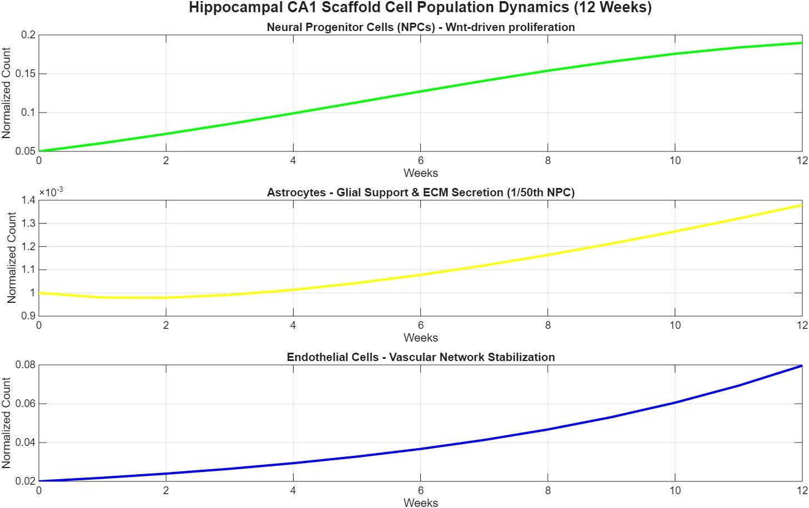
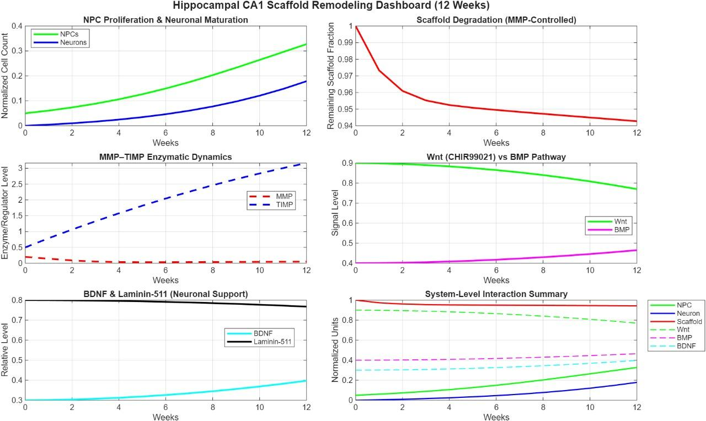
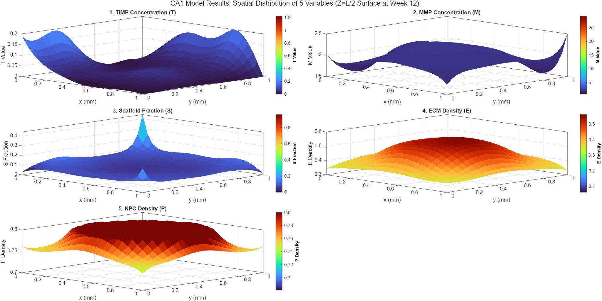
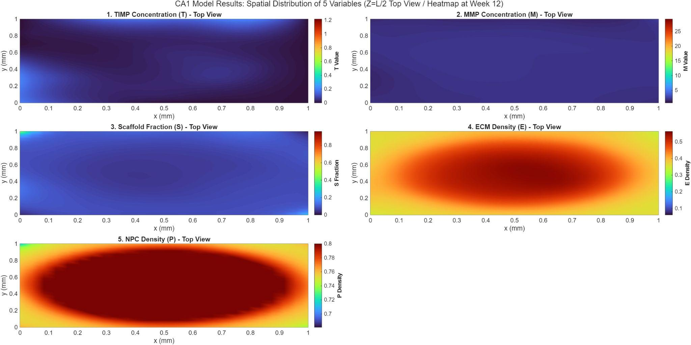
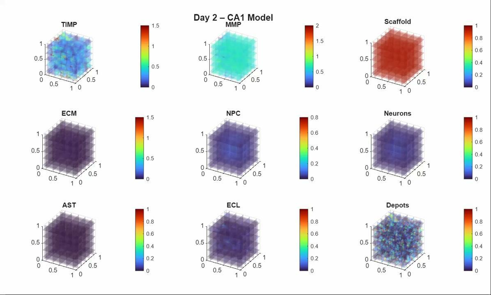

# Hippocampal CA1 Scaffold Remodeling

A computational tissue engineering model of a hyaluronic-acid (HA) scaffold placed in the hippocampal CA1 region under Alzheimer's-disease-like conditions. Six coupled differential equations describe scaffold degradation, extracellular matrix (ECM) formation and neuronal growth, with spatial heterogeneity from roughly 1,000 Gaussian diffusion sources and a 50:10:1 NPC : endothelial : astrocyte seeding ratio.

Course project for **BSE 639 (Tissue Engineering)**, Mehta Family School of Biosciences and Biomedical Engineering, **IIT Indore**.
Instructor: Dr. Hitendra Kumar.
Group 3: Arjeeta Singh, Kalyani M. Surkar, Mrinalini, Patil Namish, Priyanshi Bedi.

## What the model captures

| Component | Variable | What it represents |
|---|---|---|
| Scaffold | S | HA scaffold fraction, lost over time and space through MMP digestion |
| MMP-9 | M | Enzyme that breaks down scaffold and native ECM |
| TIMP-1 | T | Inhibitor released from depots to neutralise MMP locally |
| ECM | E | New matrix deposited by progenitor cells; replaces the scaffold |
| NPCs | P | Neural progenitor cells; proliferate under Wnt signalling, differentiate as scaffold is lost |
| Neurons | N | Total number of new mature neurons (global ODE) |
| Astrocytes, endothelial cells | AST, ECL | Glial support and vascular network (84-day model) |
| Signals | Wnt (CHIR99021), BMP, BDNF, laminin-511 | Proliferation, differentiation and neuronal support cues |

Key features:
- **1000 Gaussian depots** placed at random create spatial heterogeneity in release and diffusion.
- **Spatially varying diffusion** `D(x,y,z) = D_min + (D_max - D_min) · DepotField`, set separately for each field.
- **Cell seeding** in a 50:10:1 ratio (NPC : endothelial : astrocyte); 164 depots act as endothelial sources and 16 as astrocyte hotspots.
- **BMP ramp** from 0.02 to 0.18 between days 60 and 84, which suppresses NPC proliferation late in the run (the presentation reports a matching rise in neuron formation at this stage).

Full equations are in [`docs/model_equations.md`](docs/model_equations.md) and all parameter values in [`docs/parameters.md`](docs/parameters.md).

## Repository structure

```
.
├── README.md
├── code/
│   ├── 01_dashboard_dynamics.m            Lumped 12-week dashboard (no space)
│   ├── 02_spatial_surface_3d.m            3D PDE model, mid-plane surface plots (week 12)
│   ├── 03_spatial_surface_topview.m       Same model, top-view heatmaps (week 12)
│   └── 04_full_84day_simulation_video.m   Full 84-day model, daily images and MP4 (GPU)
├── docs/
│   ├── model_equations.md
│   └── parameters.md
├── results/                               Figures from the final presentation
└── presentation/
    └── Final_Presentation_CA1_Scaffold_Remodeling.pdf
```

| Script | Model | Grid / depots | Time | Hardware |
|---|---|---|---|---|
| `01_dashboard_dynamics.m` | Lumped week-by-week model | none | 12 weeks | CPU |
| `02_spatial_surface_3d.m` | 3D reaction-diffusion | 25³ / 25 depots | 12 weeks, `dt = 0.01` | CPU |
| `03_spatial_surface_topview.m` | same as 02 | 25³ / 25 depots | 12 weeks, `dt = 0.01` | CPU |
| `04_full_84day_simulation_video.m` | 3D model with AST, ECL, BMP schedule | 22³ / 1000 depots | 84 days, `dt = 0.1` day | CUDA GPU |

## Results

### Cell population dynamics (12 weeks)



NPCs expand steadily under Wnt stimulation. Astrocytes (about 1/50 of the NPC level) rise slowly after an initial dip, and endothelial cells increase progressively, indicating vascular network stabilisation.

### System-level remodeling dashboard (script 01)



| Quantity | Week 0 | Week 12 |
|---|---|---|
| NPCs (normalised) | 0.05 | about 0.33 |
| Neurons (normalised) | 0 | about 0.18 |
| Scaffold fraction | 1.00 | about 0.94 (most of the loss occurs in the first 2-3 weeks) |
| MMP | 0.20 | about 0.05 (falls early, then stays low) |
| TIMP | 0.50 | about 3.2 (rises steadily) |
| Wnt | 0.90 | about 0.77 |
| BMP | 0.40 | about 0.47 |
| BDNF | 0.30 | about 0.40 |
| Laminin-511 | 0.80 | about 0.77 |

In this lumped model TIMP accumulates while MMP stays low, so scaffold loss slows after the first weeks. Wnt declines slowly while BMP and BDNF rise.

### Spatial distribution at week 12, mid-plane (scripts 02 and 03)

3D surface view:



Top view:



- **TIMP (T):** concentrated toward the edges of the domain, away from the NPC-rich centre.
- **MMP (M):** remains in a limited range across the mid-plane.
- **Scaffold (S):** almost fully degraded across the mid-plane at week 12, with small residual patches near the domain corners.
- **ECM (E):** forms a high-density dome in the centre, where NPCs deposit new matrix.
- **NPCs (P):** reach maximum density (`P_max = 0.8`) in the centre, guided by the Wnt field.

### 84-day simulation (script 04)

Daily slice images are saved by the script and assembled into an MP4. Example frame (day 2): scaffold intact, depot-driven TIMP and MMP fields visible, cell fields still low.



Expected dynamics as described in the final presentation:

| Field | Days 1-40 | Days 41-60 | Days 61-84 |
|---|---|---|---|
| Scaffold (S) | Rapid clearance by MMP | Mostly depleted | Almost zero |
| MMP (M) | Rises quickly, TIMP is low | Plateaus where scaffold remains, patchy | Declines slightly as scaffold disappears |
| TIMP (T) | Decays but keeps a minimal baseline | Stable at a low level | Slight local increase where needed |
| NPC (P) | Rapid growth, saturates at `P_max` | Plateau | Proliferation suppressed as BMP ramps up |
| Neurons (N) | Very low | Still low | Sharp increase after the BMP ramp |
| AST and ECL | Slow increase following depot patterns | Steady increase | Continued, slower growth |
| BMP and Wnt | BMP low (0.02), Wnt high centrally | BMP low, Wnt dominates | BMP rises from 0.02 to 0.18 |

## How to run

1. Open MATLAB (R2020b or newer recommended) and set the current folder to `code/`.
2. Run any script with the Run button or by typing its name.

| Script | Requirements | Notes |
|---|---|---|
| 01, 02, 03 | MATLAB, no extra toolboxes | `tiledlayout` needs R2019b+, `turbo` needs R2020b+. Script 01 has a commented `exportgraphics` line to save the figure. |
| 04 | Parallel Computing Toolbox, CUDA-capable GPU | Creates `<Downloads>/tissue_images/` using `%USERPROFILE%` (Windows). Writes 84 PNGs and the MP4. Change `imageFolder` for other systems. |

Script 04 uses `parallel.gpu.enableCUDAForwardCompatibility(true)`, which is needed on some newer GPUs. Remove that line if your setup does not need it.

## Notes and limitations

- All quantities are normalised or in arbitrary units. The parameter values are model assumptions and the repository contains no calibration against experimental data.
- Time units are weeks in scripts 01-03 and days in script 04.
- Spatial derivatives use MATLAB's `del2`, which returns one sixth of the Laplacian in 3D, so the effective diffusivities are the listed `D` values divided by 6 (see [`docs/model_equations.md`](docs/model_equations.md)).
- Helper plotting functions in scripts 02 and 03 are placed at the end of the file, as MATLAB requires for local functions in scripts.
- `rng(10)` is set before the depots are drawn, so depot positions and the initial MMP noise are reproducible in MATLAB.

## Presentation

The final course presentation is in [`presentation/`](presentation/Final_Presentation_CA1_Scaffold_Remodeling.pdf).
